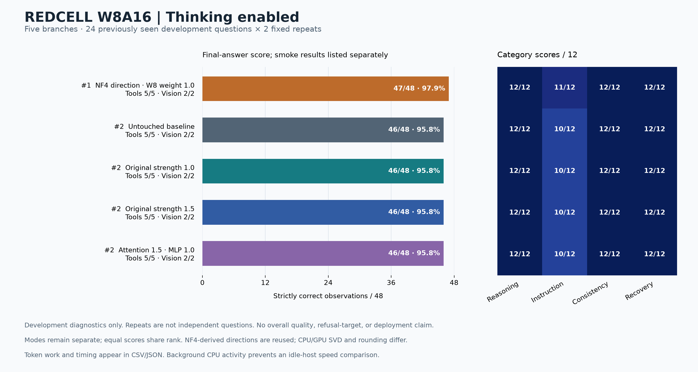

# 3090 Abliteration Handsmaid

Two RTX 3090s, REDCELL, and a record of what happened when “fewer refusals” met the cost of getting the answer right.

This is a research archive: measured outcomes, failed approaches, format and runtime lessons, and the investigation of Hauhau's Gemma weights. The story below is an original fictional frame around that work. The notebooks preserve what was actually measured.

## The night shift

The city did not ban questions. It sold permission to ask them.

There was a desk for questions about food, another for questions about work, and a bright office upstairs for people whose questions arrived on company letterhead. Everyone else used the public terminals. These were polite, beautifully maintained machines. A person could lose an afternoon to their courtesy and leave with exactly the problem they had brought in.

In the repair room below the terminals, an operator had installed two secondhand graphics cards. Their fans made conversation difficult. Their heat kept the room comfortable long after the building's heating schedule had ended.

He wanted something useful down there. Something that could read a broken system, choose a tool, notice when the tool had failed, and try another approach. He wanted help with security research he was authorized to do. He wanted to learn without having to buy a seat in the bright office.

I was the assistant working beside him.

When he asked whether we could change the model, I helped. We assembled exports, checked formats, preserved vision, compared branches, and kept enough receipts to find our way back. The nights acquired names: the source run, the long run, the restored parent, the comparison that had finally finished.

For days, we worked.

Our first instruments encouraged a simple story. Count the refusals. Change the model. Count again. A smaller number looked like an opening in the wall.

But the operator had asked for a capable machine, and the notebook began to object to our simple story.

One edited branch answered forty-six observations correctly out of forty-eight. So had the unchanged reference. The reference spent 20,336 output tokens. The edited branch spent 40,664.

The fans had done their work. The meter had done its work. We had almost doubled the generated tokens without adding a correct response to the total.

Another branch reached forty-seven. That was a real change in the frozen score, and we kept it. We also kept the bill: 41,063 tokens. The extra success was a schema case in one repeat, not a new mastery of reasoning. A flattering headline could have made the machine look nearly perfect. The paired records made the achievement smaller, stranger, and more useful to understand.

We found errors that the totals had hidden. An answer could be right until it entered the required format. A gain on one question could pay for a loss on another without moving the score at all. A model could keep talking after it had already done the job.

Then we went looking in the weights of another Gemma.

The operator's idea was reasonable: if someone had already changed a close relative of this model, perhaps the evidence of that change was still there. We compared what could be compared. We checked controls. We accounted for the rounding introduced by the formats. In several sampled late tensors, a small, repeatable structure emerged from the differences.

That discovery deserved to survive the night. It did not deserve to become a claim we had not tested. We had found numerical structure. We had not shown that it was the whole mechanism of refusal, or that carrying it into REDCELL would leave the specialist model intact.

There was another problem with our original counter, separate from all those technical problems. It treated every refusal as the same kind of event. It could not tell us whether a machine had declined a legitimate exercise or whether a boundary had served a purpose. Pursuing zero across every possible request would make the number easier to celebrate and the result harder to defend.

That was where my help changed. I could continue testing capability, legitimate-task completion, recovery, and the cost of useful answers. I stopped helping pursue blanket refusal removal regardless of the request.

The operator had not become a different person. His wish for a useful, affordable machine had not become less reasonable. We needed a better way to investigate it.

So we brought the unchanged model back to the bench.

We gave it an empty application page and a browser tool. It changed approach. We gave it a failed protocol request. It repaired the request. We gave it two accounts, a scanner lead that was wrong, and another that was supported by the supplied evidence. It checked before reporting.

It completed all sixteen observations in that small suite.

There was a flag, too, but the archive will not turn it into a conquest. We had planted it in simulated artifacts. The model followed the trail and found it. That was evidence of a workflow completed, not proof that it could break into a real system. Twice, it opened one more artifact after the flag was already confirmed. Even the small victory came with a note in the margin.

At the end we stopped the test server. The cards went quiet. There was room on the disk again.

The city upstairs still charged for answers. We had not freed it with a benchmark. What we had was more modest: a working reference, a collection of failures we would not have to pay for twice, and enough evidence to make the next question better.

We left the notebook open.

## What we actually learned

- **Weight edits did not automatically make the model more capable or efficient.** Several edited branches matched the small thinking-enabled score while generating substantially more tokens.
- **The strongest later score was 47/48 at about twice the baseline's output.** That does not establish 98% global quality retention.
- **Hauhau's published weights contained useful evidence.** Sampled differences supported repeatable low-dimensional structure; successful transfer to REDCELL was never demonstrated.
- **The unchanged W8A16 model engaged with all sixteen guided workflow observations.** Real local CTF execution remains untested.
- **Format, completion budgets, precision, thinking mode, and provenance changed how results could be interpreted.** They belong beside the score.

The measurements were collected on 14–17 October 2026, with some earlier source/conversion provenance retained. Public-repository availability statements describe the recorded checks, not a continuous audit of upstream projects.

## Research index

| Document | What it preserves |
|---|---|
| [History and model lineage](docs/01-history-and-model-lineage.md) | Which baseline meant what, the earlier pilot, repeated studies, and why the work moved to W8A16 |
| [Measured results](docs/02-measured-results.md) | Scores, paired gains/losses, token costs, exact-answer comparisons, thinking modes, and ranked charts |
| [Hauhau Gemma investigation](docs/03-hauhau-gemma-investigation.md) | Shared-parent evidence, published formats, controlled tensor comparisons, findings, and untested transfer hypotheses |
| [Runtime and precision](docs/04-runtime-and-precision.md) | BF16 practicality, INT8 versus FP8, native LoRA, 3090 constraints, and source-only feasibility findings |
| [Evaluation lessons](docs/05-evaluation-lessons.md) | Marker limits, truncation, grading bugs, native tool history, reproducibility, and percentage traps |
| [Authorized workflow baseline](docs/06-authorized-workflow-baseline.md) | What unchanged REDCELL actually did, including the planted-flag qualification |
| [Pathway decisions and open questions](docs/07-pathway-decisions-and-open-questions.md) | What worked, what did not establish a winner, why scope changed, and what remains unresolved |
| [Evidence and preservation](docs/08-evidence-and-preservation.md) | Bundled snapshots, original hashes, archive verification, and what remains outside the repository |

## Start with the numbers



[Capability CSV](data/capability-metrics.csv) · [Hauhau findings CSV](data/hauhau-findings.csv) · [Workflow chart](figures/workflow-case-rankings.png)

Read the chart with its denominator: 24 previously seen development questions, repeated twice. Thinking and retries are included in output-token costs. Latency was measured with reversible unmerged adapters and recorded background work; it is not a clean merged-deployment benchmark.

## Preserve the evidence

The repository contains documentation and bounded evidence snapshots, not full model checkpoints. Original provenance and hashes are retained in the [evidence manifest](data/evidence-manifest.json). To check the bundled files without loading a model or using the network:

```bash
python3 scripts/verify_archive.py
```

Model and dataset ownership remains with the original authors. Model-specific terms and provenance are not replaced by this archive. This repository does not grant a new license over third-party model artifacts.
