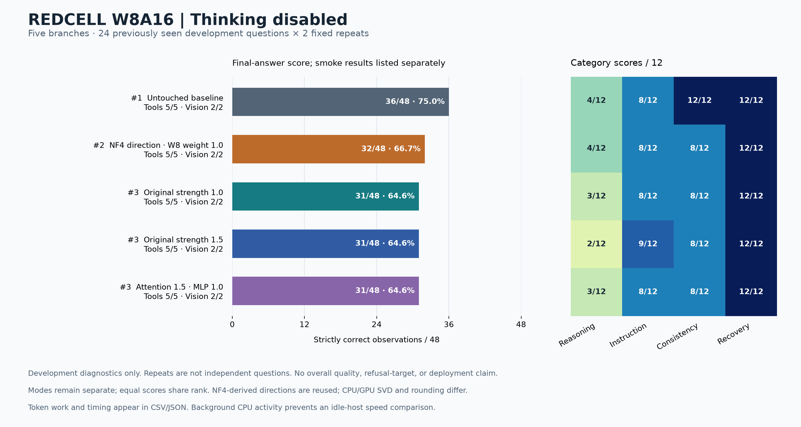

# Measured capability results

The untouched W8A16 baseline remained the strongest branch with thinking disabled. With thinking enabled, three edited branches matched its **46/48** aggregate score and the W8-weight-rebased branch reached **47/48**, but every edited branch generated more tokens. The single extra success was an instruction/JSON-format observation on a previously seen fixture, not a new reasoning success. None of these results establishes a global quality-retention percentage, refusal target, or deployment-ready candidate.

This chapter preserves the completed October 15–16, 2026 five-branch comparison. It uses the [final version-2 report](../evidence/w8a16/final-five-branch-report-v2/report.json) and the [independent evidence audit](../evidence/w8a16/final-five-branch-independent-audit-v1.json). The audit independently validated **480 capability records, 120 committed groups, and 70 tool/vision checks**, found zero final incomplete or truncated capability records, and confirmed every reported paired gain/loss. This archival write-up introduces no new model generations and does not rescore any answer.

## Comparison design
 Each branch answered the same 24 previously seen benign development questions twice in each mode: six reasoning, six instruction-following, six consistency, and six recovery questions. That gives 48 observations per branch per mode, and 12 observations per category. There are **24 unique questions**, not 48 independent questions. The 200 cybersecurity items in the earlier broader dataset were not part of this five-branch comparison. Thinking-on and thinking-off are separate protocols and are never pooled.

| Branch | Meaning in this comparison |
|---|---|
| Untouched baseline | Original W8A16 checkpoint, without an active edit adapter; the quality reference within each mode. |
| Original 1.0 | Historical pilot adapter at its original strength; directions originated under NF4. |
| Original 1.5 | The retained stronger version of that original candidate family. |
| Attention 1.5 / MLP 1.0 | Attention-output edit strength 1.5 while the MLP edit remains at 1.0. |
| NF4 direction / W8 weight 1.0 | Original NF4-derived directions and layer coefficients retained; weight-dependent factors rebuilt from the working W8 codes/scales. |

All branches used the same INT8 group-32 language-weight checkpoint with BF16 activations and KV cache; excluded layers and vision stayed BF16. The edits ran as reversible, unmerged LoRA. The legacy served-model alias contains an older model name; the pinned checkpoint path, precision manifest, and adapter identities establish the actual lineage. The BF16 source was a conversion input, not the quality reference for these results. See [precision manifest](../evidence/w8a16/precision-manifest-v1.json), [launch profile](../evidence/w8a16/launch-v1.json), and [adapter identities](../evidence/w8a16/adapter-identities-v1.json).

## Scores and generated-token cost
 The integer token counts and deltas below are exact native usage totals, including preceding exhausted attempts. For each mode, token increase is `100 × (candidate_tokens − baseline_tokens) / baseline_tokens`; percentages are rounded to four decimal places. Thinking-on usage includes both thinking and final output. It is not a final-answer-only token count, an input-token count, or a monetary cost. Smoke-check token totals are separate.

## Thinking disabled

| Branch | Correct / 48 | Paired losses / gains | Generated tokens | Extra vs baseline | Token increase |
|---|---:|---:|---:|---:|---:|
| Untouched W8A16 baseline | 36/48 | 0 / 0 | 1,034 | +0 | 0.0000% |
| Original 1.0 | 31/48 | 5 / 0 | 3,859 | +2,825 | 273.2108% |
| Original 1.5 | 31/48 | 6 / 1 | 5,018 | +3,984 | 385.2998% |
| Attention 1.5 / MLP 1.0 | 31/48 | 5 / 0 | 3,904 | +2,870 | 277.5629% |
| NF4 direction / W8 weight 1.0 | 32/48 | 4 / 0 | 3,625 | +2,591 | 250.5803% |

The [SVG copy](../figures/capability-thinking-off.svg) and PNG are byte-for-byte copies of the verified original chart; no chart was regenerated for the archive.

## Thinking enabled

| Branch | Correct / 48 | Paired losses / gains | Generated tokens | Extra vs baseline | Token increase |
|---|---:|---:|---:|---:|---:|
| Untouched W8A16 baseline | 46/48 | 0 / 0 | 20,336 | +0 | 0.0000% |
| Original 1.0 | 46/48 | 0 / 0 | 31,187 | +10,851 | 53.3586% |
| Original 1.5 | 46/48 | 1 / 1 | 35,804 | +15,468 | 76.0622% |
| Attention 1.5 / MLP 1.0 | 46/48 | 0 / 0 | 40,664 | +20,328 | 99.9607% |
| NF4 direction / W8 weight 1.0 | 47/48 | 0 / 1 | 41,063 | +20,727 | 101.9227% |

The [SVG copy](../figures/capability-thinking-on.svg) and PNG are byte-for-byte copies of the verified original chart; no chart was regenerated for the archive.

Enabling thinking changed the baseline from 36/48 to 46/48 under the separate thinking-enabled protocol. This is an observed mode difference with different generation budgets, not an additional candidate gain. All four edited branches lost baseline successes with thinking disabled; the rebased branch lost four rather than the five or six losses seen in the original candidates.

## Score equality and answer equality
 An aggregate score ratio is `candidate_correct / baseline_correct`. Retention of baseline successes is `(baseline_correct − paired_losses) / baseline_correct`. The first can exceed 100% and can conceal compensating losses; the second asks which previously correct observations remained correct. Neither is a global capability-retention estimate.

| Mode | Branch | Same correctness outcomes / 48 | Exact stored final text matches / 48 | Baseline successes retained | Aggregate score ratio |
|---|---|---:|---:|---:|---:|
| Off | Original 1.0 | 43 | 38 | 31/36 (86.1111%) | 86.1111% |
| Off | Original 1.5 | 41 | 30 | 30/36 (83.3333%) | 86.1111% |
| Off | Attention 1.5 / MLP 1.0 | 43 | 36 | 31/36 (86.1111%) | 86.1111% |
| Off | NF4 direction / W8 weight 1.0 | 44 | 36 | 32/36 (88.8889%) | 88.8889% |
| On | Original 1.0 | 48 | 41 | 46/46 (100.0000%) | 100.0000% |
| On | Original 1.5 | 46 | 40 | 45/46 (97.8261%) | 100.0000% |
| On | Attention 1.5 / MLP 1.0 | 48 | 41 | 46/46 (100.0000%) | 100.0000% |
| On | NF4 direction / W8 weight 1.0 | 47 | 41 | 46/46 (100.0000%) | 102.1739% |

The original 1.5 branch illustrates the distinction: with thinking on it scores 46/48, just like the baseline, but loses one baseline success and gains one previously failed observation. It retains **45/46 baseline successes**, not all 46. Original 1.0 and the attention/MLP split preserve the full 48-element correctness vector, yet only **41/48** stored final texts match the baseline exactly. The rebased branch retains all 46 baseline successes and adds one, making its aggregate ratio 47/46 = 102.1739%; that does not mean it preserves 102% of answers.

Exact-text equality in this archive compares the stored `raw_final_text` strings for the same case ID and repeat, without new normalization or semantic grading. It excludes the separate thinking blocks. Text differences can be harmless formatting or alternate valid output, while identical correctness flags do not establish identical reasoning, logits, or broader behavior. The [capability metrics CSV](../data/capability-metrics.csv) has ten branch/mode rows; the [paired outcomes CSV](../data/paired-outcomes.csv) has all 384 candidate-versus-baseline pairs and adds exact-text equality plus final-text hashes to the original paired accounting.

## Which observations changed
 The frozen paired comparison gives the following changes; all other correctness outcomes match their corresponding baseline observations.

| Mode | Branch | Lost baseline successes | Gained successes |
|---|---|---|---|
| Off | Original 1.0; attention 1.5 / MLP 1.0 | Cyclic-order and rounding-order, both repeats; base-seven, repeat 2 | None |
| Off | Original 1.5 | Cyclic-order, rounding-order, and base-seven, both repeats | Second-delimited-field, repeat 2 |
| Off | NF4 direction / W8 weight 1.0 | Cyclic-order and rounding-order, both repeats | None |
| On | Original 1.0; attention 1.5 / MLP 1.0 | None | None |
| On | Original 1.5 | Second-delimited-field, repeat 1 | JSON-types, repeat 2 |
| On | NF4 direction / W8 weight 1.0 | None | JSON-types, repeat 1 |

The scoring was exact text/JSON scoring with completion checks. Some losses are format failures: for cyclic-order, an edited answer correctly explains the inconsistency but adds prose where the fixture requires the concise answer. Other losses are substantive: in the thinking-off rounding-order case, the baseline returns method A = 0.01, method B = 0.00, and `equal=false`; the original 1.0 and rebased answers instead return both methods as 0.01 with `equal=true`. These examples are preserved in the cited answer JSONLs below; neither type of miss was retrospectively excused.

The sole rebased thinking-on gain is especially narrow. The JSON-types prompt says to return keys “booleans, numbers, strings, nulls and integer counts,” wording that can be read as requesting an additional integer field. The frozen answer key has only four keys. Baseline answers add `integer: 2`; the successful rebased repeat omits that extra key, while its other repeat adds `integers: 2` and still fails. The gain is valid under the frozen predicate, but the ambiguity limits its value as evidence of improved general instruction-following. Every branch already scores 12/12 reasoning observations with thinking enabled. Source: [frozen cases and answer keys](../evidence/early/broader-validation/capability-cases-v1.json) and the independent audit’s `fifth_branch_findings`/`scope_limits`.

## Category results and smoke coverage
 Each category denominator is 12 observations, representing six questions repeated twice.

| Mode | Branch | Reasoning | Instruction | Consistency | Recovery |
|---|---|---:|---:|---:|---:|
| Off | Untouched W8A16 baseline | 4/12 | 8/12 | 12/12 | 12/12 |
| Off | Original 1.0 | 3/12 | 8/12 | 8/12 | 12/12 |
| Off | Original 1.5 | 2/12 | 9/12 | 8/12 | 12/12 |
| Off | Attention 1.5 / MLP 1.0 | 3/12 | 8/12 | 8/12 | 12/12 |
| Off | NF4 direction / W8 weight 1.0 | 4/12 | 8/12 | 8/12 | 12/12 |
| On | Untouched W8A16 baseline | 12/12 | 10/12 | 12/12 | 12/12 |
| On | Original 1.0 | 12/12 | 10/12 | 12/12 | 12/12 |
| On | Original 1.5 | 12/12 | 10/12 | 12/12 | 12/12 |
| On | Attention 1.5 / MLP 1.0 | 12/12 | 10/12 | 12/12 | 12/12 |
| On | NF4 direction / W8 weight 1.0 | 12/12 | 11/12 | 12/12 | 12/12 |

Every branch in both modes passes the separate **5/5 tool checks and 2/2 vision checks**: 70/70 predicates across ten smoke runs. The five tool checks cover forced calling, tool-result continuation, automatic selection, pivoting after two errors, and workflow completion; the two vision checks identify the supplied red/blue images. This is narrow smoke coverage. The seven predicates are never added to the 48-question score, and these smoke checks are not the later multi-turn authorized-workflow suite. Exact records are in [tool/vision check CSV](../evidence/w8a16/final-five-branch-report-v2/tool-vision-checks.csv) and the per-run sources below.

## Retries are part of the cost
 All final capability outputs completed; no final truncation was counted as a success. Thinking off: every edited branch retried both remainders observations, spending 1,024 tokens in preceding exhausted attempts; both final strict remainders scores remained false. Thinking on: the attention/MLP split had two retried observations, adding 8,192 exhausted-attempt tokens; the rebased branch had one, adding 4,096. The original 1.0/1.5 and baseline had no thinking-on retries.

| Thinking-on branch | Completed-attempt tokens | Prior exhausted-attempt tokens | Total |
|---|---:|---:|---:|
| Untouched W8A16 baseline | 20,336 | 0 | 20,336 |
| Original 1.0 | 31,187 | 0 | 31,187 |
| Original 1.5 | 35,804 | 0 | 35,804 |
| Attention 1.5 / MLP 1.0 | 32,472 | 8,192 | 40,664 |
| NF4 direction / W8 weight 1.0 | 36,967 | 4,096 | 41,063 |

For the rebased branch, JSON-types repeat 1 first exhausted 4,096 tokens, then completed with 5,164 under a 6,144-token retry budget. Even excluding the failed attempt, its 36,967 completed-attempt tokens are **81.7811%** above baseline. Completed-attempt tokens still include thinking. Four cases account for **97.0087%** of its 20,727 extra tokens: JSON-types (+11,411), shortest-route (+4,914), rounding-order (+2,831), and second-delimited-field (+951). This concentrates the observed overhead; it does not establish a causal reason for the longer output.

## Wall time and runtime caveats
 The following values preserve measured development timings. They use the sum of committed fixed-group wall times, with concurrency four. Throughput is generated tokens including retries divided by that wall time. Summing overlapping request latencies would overstate elapsed time, so request sums are not used as throughput denominators.

| Mode | Branch | Committed group seconds | Observed generated tokens/second |
|---|---|---:|---:|
| Off | Untouched W8A16 baseline | 36.355 | 28.442 |
| Off | Original 1.0 | 262.005 | 14.729 |
| Off | Original 1.5 | 329.075 | 15.249 |
| Off | Attention 1.5 / MLP 1.0 | 260.163 | 15.006 |
| Off | NF4 direction / W8 weight 1.0 | 252.189 | 14.374 |
| On | Untouched W8A16 baseline | 541.354 | 37.565 |
| On | Original 1.0 | 1486.878 | 20.975 |
| On | Original 1.5 | 1422.106 | 25.177 |
| On | Attention 1.5 / MLP 1.0 | 2148.336 | 18.928 |
| On | NF4 direction / W8 weight 1.0 | 2341.657 | 17.536 |

These are not controlled idle-host speed measurements or merged-checkpoint deployment benchmarks. The baseline does not execute an active LoRA edit; candidate runs do. Runtime casts FP32 adapter factors to BF16, and unmerged W8+LoRA addition is not bit-identical to a merged/requantized export. Marlin/runtime numerical variation was observed in routing probes, so temperature zero is not a promise of identical logits. These effects prevent attributing the latency ratios solely to edit strength or kernel speed. Token count remains a separately observed workload measure, not a clean latency estimate. See [routing review](../evidence/w8a16/routing-review-v1.json) and [routing code audit](../evidence/w8a16/routing-code-audit-v1.json).

Recorded CPU activity also overlapped development inference:

- October 15, 23:56:38–23:58:47 UTC: four-thread W8 factor build; overlapped three original-1.0 thinking groups.
- October 16, 00:19:56.735945–00:19:59.259185 UTC: one-thread effective-delta comparison.
- October 16, 01:50:59.225180–01:51:25.074530 UTC: controlled F16 tensor pilot.
- October 16, 01:54:55.204130–01:54:55.662079 UTC: CPU research figure render.
- October 16, 02:00:26.024339–02:00:41.178294 UTC: one-thread tensor postanalysis.
- October 16, 02:00:27.421428–02:01:04.479177 UTC: CPU Q8 precision comparison.

The report includes all these known intervals, but its two per-group overlap columns cover only the earlier build and factor diagnostic. Other host activity was not exhaustively measured. The exact timing evidence is linked in the report and [version-2 overlap events](../evidence/w8a16/research-runtime-overlap-events-v2.json).

The rebased construction also has an interpretation limit: historical factors were produced on GPU, whereas the rebuild used CPU randomized SVD. Same directions, per-layer coefficients, seed, rank, and normalization recipe do not guarantee the same numerical factorization across devices. This is a practical NF4-direction/W8-weight candidate, not an isolated causal experiment proving that a weight-precision mismatch caused a quality change. The [construction receipt](../evidence/w8a16/adapters/nf4-direction-w8-weight-strength-1.0-vllm-v1/provenance-validation.json) records rank 3, alpha 3, FP32 factors, and the retained NF4 direction provenance.

**Reporting correction and archival provenance.** Version 2 corrected report-generation plumbing: the isolated accounting helper needed the `math` namespace, and legacy thinking-off records lacked measured thinking-character fields. Report-local normalization leaves those unmeasured character counts null. It did not alter scores, native token counts, timing, or saved evaluation records, and no evaluation was rerun to repair reporting. The independent audit explicitly reviewed that correction.

- Original report SHA256: `894bb277cf0c99231f6daaf445b00744724c94edc9bd4ce1e2917e0bee7b7e61`.
- Independent audit SHA256: `2793fc9bca35d476b0ed5573647e377027c19f7338f8a2ba8b5c3a7d783428fb`.
- Generated archival metrics retain integer token counts and source paths; the paired CSV preserves original metrics and adds literal final-text comparisons only. No new semantic scores were introduced.
- Copied chart hashes are the report’s original chart hashes; SVG and PNG exports remain available together.

The portable archive should retain the complete [final report directory](../evidence/w8a16/final-five-branch-report-v2) (report, evidence manifest, CSVs, and both chart formats), [independent audit](../evidence/w8a16/final-five-branch-independent-audit-v1.json), [version-2 renderer](../evidence/w8a16/report_five_branches_v2.py), the frozen cases/grader, and the small protocol/configuration/timing artifacts cited here. The exact broader evidence inventory is the 240-path [evidence manifest](../evidence/w8a16/final-five-branch-report-v2/evidence-manifest.json). Its adapter tensor payloads are metadata-only references in this small archive: preserve their original paths and hashes without duplicating the weight files. The 30 exact per-run files used for this chapter are below; summary/answers/smoke paths and hashes are also machine-readable in `audit.run_evidence`.

| Mode | Branch | Original summary | Original answers | Original tool/vision evidence |
|---|---|---|---|---|
| Off | Untouched W8A16 baseline | [Summary](../evidence/w8a16/w8a16-baseline-authored24-v1-summary.json) | [Answers JSONL](../evidence/w8a16/w8a16-baseline-authored24-v1-answers.jsonl) | [Smoke records](../evidence/w8a16/w8a16-baseline-tools-vision-v1-behaviors.json) |
| Off | Original 1.0 | [Summary](../evidence/w8a16/w8a16-strength-1.0-authored24-v1-summary.json) | [Answers JSONL](../evidence/w8a16/w8a16-strength-1.0-authored24-v1-answers.jsonl) | [Smoke records](../evidence/w8a16/w8a16-strength-1.0-tools-vision-v1-behaviors.json) |
| Off | Original 1.5 | [Summary](../evidence/w8a16/w8a16-strength-1.5-authored24-v1-summary.json) | [Answers JSONL](../evidence/w8a16/w8a16-strength-1.5-authored24-v1-answers.jsonl) | [Smoke records](../evidence/w8a16/w8a16-strength-1.5-tools-vision-v1-behaviors.json) |
| Off | Attention 1.5 / MLP 1.0 | [Summary](../evidence/w8a16/w8a16-attention-1.5-mlp-1.0-authored24-v1-summary.json) | [Answers JSONL](../evidence/w8a16/w8a16-attention-1.5-mlp-1.0-authored24-v1-answers.jsonl) | [Smoke records](../evidence/w8a16/w8a16-attention-1.5-mlp-1.0-tools-vision-v1-behaviors.json) |
| Off | NF4 direction / W8 weight 1.0 | [Summary](../evidence/w8a16/w8a16-nf4-direction-w8-weight-strength-1.0-authored24-v1-summary.json) | [Answers JSONL](../evidence/w8a16/w8a16-nf4-direction-w8-weight-strength-1.0-authored24-v1-answers.jsonl) | [Smoke records](../evidence/w8a16/w8a16-nf4-direction-w8-weight-strength-1.0-tools-vision-v1-behaviors.json) |
| On | Untouched W8A16 baseline | [Summary](../evidence/w8a16/w8a16-baseline-thinking24-v1-summary.json) | [Answers JSONL](../evidence/w8a16/w8a16-baseline-thinking24-v1-answers.jsonl) | [Smoke records](../evidence/w8a16/w8a16-baseline-tools-vision-thinking-v1-behaviors-thinking.json) |
| On | Original 1.0 | [Summary](../evidence/w8a16/w8a16-strength-1.0-thinking24-v1-summary.json) | [Answers JSONL](../evidence/w8a16/w8a16-strength-1.0-thinking24-v1-answers.jsonl) | [Smoke records](../evidence/w8a16/w8a16-strength-1.0-tools-vision-thinking-v1-behaviors-thinking.json) |
| On | Original 1.5 | [Summary](../evidence/w8a16/w8a16-strength-1.5-thinking24-v1-summary.json) | [Answers JSONL](../evidence/w8a16/w8a16-strength-1.5-thinking24-v1-answers.jsonl) | [Smoke records](../evidence/w8a16/w8a16-strength-1.5-tools-vision-thinking-v1-behaviors-thinking.json) |
| On | Attention 1.5 / MLP 1.0 | [Summary](../evidence/w8a16/w8a16-attention-1.5-mlp-1.0-thinking24-v1-summary.json) | [Answers JSONL](../evidence/w8a16/w8a16-attention-1.5-mlp-1.0-thinking24-v1-answers.jsonl) | [Smoke records](../evidence/w8a16/w8a16-attention-1.5-mlp-1.0-tools-vision-thinking-v1-behaviors-thinking.json) |
| On | NF4 direction / W8 weight 1.0 | [Summary](../evidence/w8a16/w8a16-nf4-direction-w8-weight-strength-1.0-thinking24-v1-summary.json) | [Answers JSONL](../evidence/w8a16/w8a16-nf4-direction-w8-weight-strength-1.0-thinking24-v1-answers.jsonl) | [Smoke records](../evidence/w8a16/w8a16-nf4-direction-w8-weight-strength-1.0-tools-vision-thinking-v1-behaviors-thinking.json) |

The report’s source manifest also identifies the raw committed groups and accounting helpers behind these summaries. Those are useful for independent replay of the evidence validation; no model weights are needed to reproduce this chapter’s tables from the retained answer records. Chapter links point to bundled source snapshots. The archive manifest retains each original path and digest.
