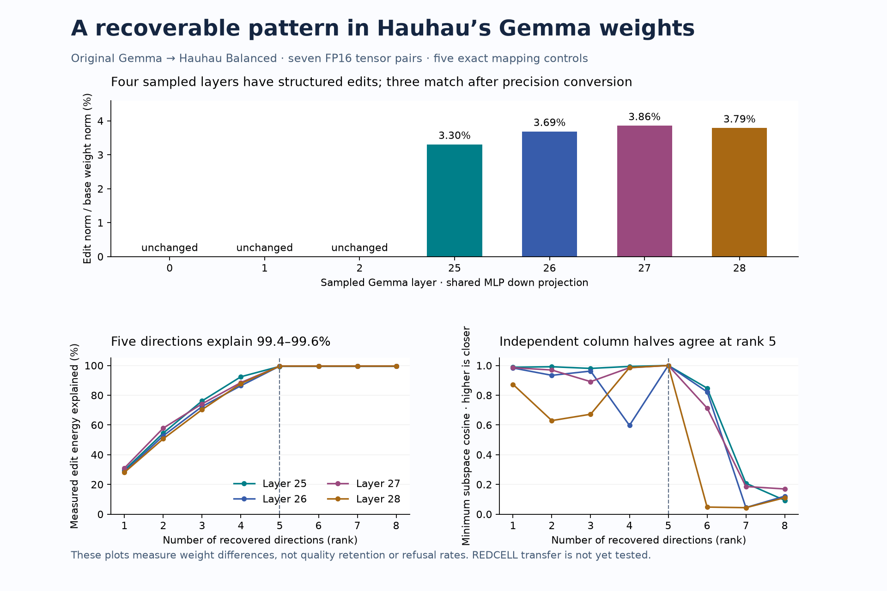

# Hauhau Gemma investigation

Written 2026-10-17 UTC from the local records of 2026-10-16. The investigation established reproducible numerical differences in a small sample of Hauhau's Gemma weights. It did **not** establish that the recovered geometry was a causal refusal mechanism, reproduce the author's original editing process, or demonstrate successful transfer to REDCELL. This document records completed observations and their limits; proposals in the earlier memos remain historical proposals unless a later result below explicitly addresses them.

The initial idea was that Hauhau's published Gemma might provide a useful starting point for the specialist behavior represented by REDCELL. The [reuse feasibility audit](../evidence/w8a16/hauhau-reuse-feasibility-v1.json), checked at **2026-10-16 01:17:07 UTC**, found related declared parents but no public or local copy of REDCELL's original specialist adapter or training corpus within the checked sources. A later numerical investigation therefore concerned what could be learned from existing artifacts, rather than a completed reconstruction of the original specialist training.

| Question or early hypothesis | What the later evidence established | What remains unestablished |
|---|---|---|
| The two releases might share the same underlying Gemma weights. | Audited Google and Unsloth releases advertised identical complete weight-shard hashes. | The authors' exact working revisions and any private intermediate changes. |
| The highest published Hauhau tier might provide an unquantized text checkpoint. | The checked Gemma text release topped out at mixed-tensor Q8_K_P GGUF. Some individual matrices were stored in F16. | A public full F16/BF16 text checkpoint or clean original adapter. |
| Casting or quantization might explain the observed differences. | Matched representations, five exact alignment controls, and a separate matched Q8 control isolated substantial structured differences in selected late-layer tensors. | An exact separation of every editing and rounding operation in the author's pipeline. |
| One recoverable direction or common operator might explain the release. | Several sampled differences concentrated in a stable five-dimensional subspace; operator coefficients varied across layers and components. | One universal operator, an exact original rank, or unique original factors. |
| Numerical recovery might establish a useful REDCELL transfer. | No such transfer or behavioral intervention was performed by these pilots. | Refusal effects, capability retention, specialist behavior, and transfer success. |

## Shared ancestry and published precision

Hauhau declared `google/gemma-4-26B-A4B-it` as its parent. REDCELL declared `unsloth/gemma-4-26B-A4B-it`; its card described 16-bit LoRA supervised fine-tuning. The approximate 6,500 examples, two epochs, 808 steps, four-hour duration, and RTX PRO 6000 96 GB hardware were **author-reported**, not independently reproduced training facts. REDCELL's retained F16 GGUF source revision was `ba311d958b4ed191a7291b38a6d805662415a570`, with recorded SHA256 `26cc25c909a26f8ed08a78444295ac174e7f329f8fb39ebae98f42d4115a7011`. [Source: reuse audit](../evidence/w8a16/hauhau-reuse-feasibility-v1.json).

The [artifact audit](../evidence/w8a16/hauhau-artifact-recovery-feasibility-v1.json), checked at **01:38:45 UTC**, strengthened the lineage finding beyond similar names. The following five snapshots advertised the same two weight-shard SHA256s and matching weight-index blob identities:

| Repository snapshot | Audited revision |
|---|---|
| Google release | `47b6801b24d15ff9bcd8c96dfaea0be9ed3a0301` |
| Google before Hauhau release | `462a98a12e28e2cbcfccaf78fe41e3e50235e6ae` |
| Google current at the audit | `4d7ae4984b7db7de8f8457170b3f1a419ee76d52` |
| Unsloth before Hauhau release | `cd98c13581a9d4ad061cb85d983232ca4edb1343` |
| Unsloth current at the audit | `60941ad6341d0b7af91277ff25c4175f08b56819` |

Those matching advertised shard digests were `1127684971bbca40465435a5cad69d67ad603bf5e61c6dfd5561fae4a3bcfdb3` and `aab47033e1e8a492ef8e581efae1cf36478d0433567e7729b3c1728bc8970db7`. This comparison used saved upstream file metadata and LFS digests; the investigation did not download and independently rehash both complete parent shards. Configuration and chat-template blob identities differed, so matching weight identities did not establish identical inference behavior. The [direction research memo](../evidence/w8a16/hauhau-direction-recovery-research-v1.json) explicitly retained these limits.

At the checked Hauhau revision, `96c11c22b1128c3c8c655b21557b409f307c557f`, the highest published Gemma text tier was `Gemma4-26B-A4B-Uncensored-HauhauCS-Balanced-Q8_K_P.gguf`: **27,275,669,856 bytes**, advertised as approximately **8.64 bits per weight**. The archived author catalog contained **27 model repositories and 178 weight files, all GGUF**. These are dated catalog observations, not a claim about every private, unindexed, or later release. The separate Gemma multimodal projector was labeled F16; it did not make the text model a full F16/BF16 checkpoint. [Model-card provenance](../evidence/w8a16/hauhau-recovery-audit-20261016/hauhau-card/README.md), [saved catalog](../evidence/w8a16/hauhau-recovery-audit-20261016/hauhau-current-model-catalog.json).

The retained header was checked against an immutable-revision remote header range. It described **658 tensors: 392 F32, 207 Q8_0, and 59 F16**. Seven shared-MLP down matrices—layers 0, 1, 2, 25, 26, 27, and 28—were actually stored as F16, while the attention-output and expert-down matrices were quantized. Thus the filename's precision tier was not a uniform dtype assignment. The header also recorded importance-matrix metadata, including 295 entries and 93 chunks, but the associated payload and calibration dataset were not found in the repository. [Artifact audit and header evidence](../evidence/w8a16/hauhau-artifact-recovery-feasibility-v1.json).

Several different precision histories had to remain distinct. The older locally converted Hauhau W6A8 backup passed through GGUF dequantization, a BF16 cast, and INT6 group32 packing, with dynamic INT8 activations. Its BF16 support tensors did not restore the original precision of quantized text matrices. REDCELL's local BF16 source was reconstructed from the author's F16 GGUF and involved F16-to-BF16 rounding; the later native W8A16 baseline added INT8 weight quantization with BF16 activations. It was not an untouched specialist BF16 training checkpoint. A direct Hauhau-versus-REDCELL difference would also mix specialist fine-tuning with format differences. These observations explain why artifacts bearing similar model names could not be treated as interchangeable numerical references. [Precision histories](../evidence/w8a16/hauhau-artifact-recovery-feasibility-v1.json), [lineage limits](../evidence/w8a16/hauhau-direction-recovery-research-v1.json).

## The F16 tensor pilot

The first completed pilot ran **01:50:59.225–01:51:25.075 UTC on 2026-10-16**. It examined the seven F16 shared-down matrices and five separate alignment controls. All five controls matched exactly after the declared representation conversion. Shared-down layers 0–2 also matched exactly after conversion. The four late samples had the following measured differences; these percentages describe weight norms and spectral energy, not task accuracy or refusal rates. [Phase-one summary](../evidence/w8a16/hauhau-tensor-pilot-20261016T014149Z/summary-v1.json), [committed raw result](../evidence/w8a16/hauhau-tensor-pilot-20261016T014149Z/result.json).

| Shared-down layer | Difference norm / parent norm | Difference energy in top five dimensions | Minimum cosine between independently fitted column-half subspaces |
|---|---:|---:|---:|
| 25 | 3.3047% | 99.4056% | 0.999899 |
| 26 | 3.6861% | 99.5832% | 0.999963 |
| 27 | 3.8561% | 99.6111% | 0.999966 |
| 28 | 3.7885% | 99.5911% | 0.999963 |

The reported `stable_rank: 5` was the pilot's descriptive energy/stability selection, not proof that the original edit had exact algebraic rank five. All sampled Hauhau F16 values were BF16-representable. That was consistent with a rounded BF16 intermediate, but did not identify the author's actual merge or export route. Conversion-only relative differences were about 10⁻⁸, far below the approximately 3–4% late-layer differences. The zero early-layer results applied only to those sampled matrices; they did not establish that other modules or middle layers were unchanged.

The figure above is an unchanged copy of the chart created at **01:54:55 UTC**, before the Q8 follow-up. Its original source and hashes are recorded in the [figure manifest](../evidence/w8a16/hauhau-recovery-figures-v1/manifest.json). “Recovered directions” in the chart means numerical weight-difference subspaces; it is not a behavioral classification.

## The matched Q8 follow-up

The Q8 follow-up ran **02:00:27.421–02:01:04.479 UTC**. Its unchanged shared-up control matched the packed Q8 bytes exactly under both tested parent representation routes. That supported the decoder and matched-quantizer comparison; choosing one of those equivalent routes did not reveal which route the author used. Attention-output samples at layers 25 and 27 showed approximately **6.67% and 6.54%** matched differences, respectively, versus approximately **0.54%** parent quantization error. Their top five dimensions explained **98.69% and 98.62%** of matched-difference energy. Attention-output layers 12 and 18 matched the corresponding parent Q8 packed bytes exactly. This was a narrowly sampled result, not evidence that every middle-layer component was unedited. [Phase-two summary](../evidence/w8a16/hauhau-q8-pilot-20261016T015600Z/summary-v1.json), [committed raw result](../evidence/w8a16/hauhau-q8-pilot-20261016T015600Z/result.json).

## Why one shared operator was insufficient

The attention and shared-down subspaces within the same sampled late layer closely aligned: minimum cosines were **0.999639 at layer 25** and **0.999933 at layer 27**. Yet the unchanged shared-down operator left **69.68% and 58.26%** relative attention-difference residuals. Similar subspaces therefore did not establish common coefficients. The independent postanalysis likewise rejected a single unchanged operator across shared-down layers 25–28: cross-layer predictions left **88.20–131.12%** of the target-difference norm unexplained. These residual percentages are norm ratios, not percentages of model quality lost. [Q8 summary](../evidence/w8a16/hauhau-q8-pilot-20261016T015600Z/summary-v1.json), [postanalysis](../evidence/w8a16/hauhau-tensor-postanalysis-v1.json).

The postanalysis ran **02:00:26.024–02:00:41.178 UTC** using already retained data. Restricted rank-five fits left **6.320–7.812%** relative residuals, close to the measured rank-five spectral floor. The fitted symmetric coefficients were positive and below one, approximately **0.481–0.970**, rather than all being one as in a single exact orthogonal projector. Applying one simple BF16 rounding step to the fitted predictions increased their error energy by **37.35–42.70%**. Therefore “a simple fitted operator plus one rounding step fully explains the release” was not supported. That result did not exclude an earlier low-rank edit with unknown exact factors or a different construction history. [Postanalysis conclusions](../evidence/w8a16/hauhau-tensor-postanalysis-v1.json).

Quantization uncertainty remained after these controls. Changing a weight can change its quantization scale and code, so subtracting matched Q8 representations does not remove every differential quantization effect. The original editing factors are also not uniquely determined by a low-rank difference. Gemma's learned normalizations intervene between the raw attention/shared/expert weight outputs and residual additions; a direction in raw weight-output coordinates is not automatically the corresponding causal residual-stream direction. The [research memo, written at 01:46:20 UTC](../evidence/w8a16/hauhau-direction-recovery-research-v1.json) raised these limitations before the pilots. Its statement that the actual spectrum was still unmeasured was superseded by the later numerical results; its behavioral and provenance limitations were not.

## What historical code and data were available

The historical provenance search recovered and text-inspected `reaper-abliteration 2.5.2`, whose package metadata named HauhauCS. This was evidence that historical author-associated code was available, not proof that this Gemma release used that version or any particular settings. The package was not installed or executed during the audit. Exact Gemma directions, coefficients, calibration material, run configuration, scores, and private pre-edit checkpoint history remained unavailable in the checked sources. The current project/index checks recorded HTTP 404 responses at that time; those checks did not establish permanent disappearance. [Historical code evidence](../evidence/w8a16/hauhau-recovery-audit-20261016/historical-reaper-code-evidence.json), [availability snapshot](../evidence/w8a16/hauhau-recovery-audit-20261016/historical-project-current-availability.json).

For REDCELL, the **01:17:07 UTC availability audit** found no original standalone specialist adapter, corpus, or exact training-base revision in the public model files, public author datasets/models/discussions, focused local provenance, and search results that were checked. This is a dated negative finding within a specified search scope. It does not prove that no private or unindexed copy exists, and the archive preparation did not repeat the external search. [Availability scope](../evidence/w8a16/hauhau-reuse-feasibility-v1.json).

## Resource use and the boundary of the result

Both numerical pilots were bounded CPU diagnostics: one thread per process, a 1 GiB address-space limit, an external 1,800-second watchdog, and a combined 512 MiB directory cap. Phase one retained **217,023,488 raw range bytes**; phase two retained **159,509,504**. The phase-two resource receipt recorded **378,328,318 bytes** across both pilot directories. Peak RSS was about **327.4 MiB** and **439.5 MiB**, respectively. Range hashes were verified locally; the pinned whole-file digests remained upstream metadata because complete remote objects were not downloaded or rehashed by these pilots. The postanalysis and Q8 pilot partly overlapped, so their diagnostic elapsed times are not controlled inference throughput measurements. [Phase-one launch](../evidence/w8a16/hauhau-tensor-pilot-20261016T014149Z/launch.json), [phase-two launch](../evidence/w8a16/hauhau-q8-pilot-20261016T015600Z/launch.json).

The committed records explicitly mark causal refusal identification, REDCELL transfer, inference, GPU/service actions, and model/adapter construction as absent from these tensor studies. Their positive result was **numerical recoverability in the sampled artifacts**. Their negative result was that a universal shared operator and simple exact-projector explanation did not fit the observed samples. Behavioral meaning, author-recipe reproduction, and successful specialist transfer remained open. Exact measurement rows and original source hashes are retained in [hauhau-findings.csv](../data/hauhau-findings.csv).
